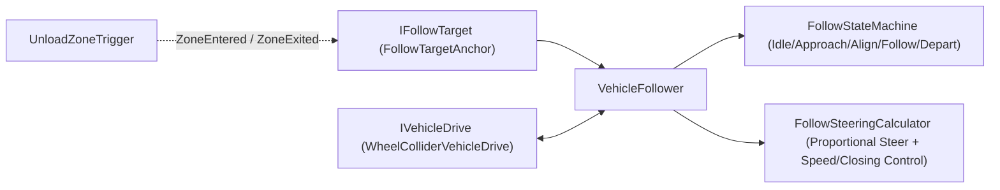

# Vehicle Follow (`com.schaeffergui.vehicle-follow`)

Modular lateral vehicle-following, alignment, and unloading-zone state machine for Unity (`6000.0+`).

Originally designed around agricultural unloading scenarios where a support truck approaches a moving harvester, aligns alongside its unloading auger, matches speed during transfer, and departs when finished.

## Features
- **Dependency-free Core (`VehicleFollow.Core`)**: pure C# steering calculator (`FollowSteeringCalculator`) and state machine (`FollowStateMachine`) with `noEngineReferences: true`.
- **State Machine with Hysteresis**: `Idle -> Approach -> Align -> Follow -> Depart -> Idle`, with configurable enter/exit thresholds and lifecycle events (`OnAligned`, `OnFollowStarted`, `OnFollowFinished`, `OnDeparted`).
- **Interface-driven**: decouples physics/actuation (`IVehicleDrive`) and target tracking (`IFollowTarget`) from Unity or third-party vehicle physics packages.
- **Unity Runtime (`VehicleFollow.Unity`)**: includes `VehicleFollower`, `WheelColliderVehicleDrive`, `FollowTargetAnchor`, and `UnloadZoneTrigger`.
- **Prefab-free Sample**: `Samples~/WheelColliderDemo` spawns a moving leader and a 4-wheel `WheelCollider` follower at runtime.

## Installation

Add via **Unity Package Manager -> Add package from git URL**:

```text
https://github.com/schaeffergui/unity-vehicle-follow.git#dev
```

Or add directly to your project's `Packages/manifest.json`:

```json
{
  "dependencies": {
    "com.schaeffergui.vehicle-follow": "https://github.com/schaeffergui/unity-vehicle-follow.git#dev"
  }
}
```

## Architecture



## Public API Summary

### `VehicleFollow.Core`
- `IVehicleDrive`: `float CurrentSpeed`, `void ApplyDrive(DriveCommand command)`.
- `IFollowTarget`: `FollowPose AnchorPose`, `FollowVector3 Velocity`, `bool IsCallActive`, `bool IsUnloading`, `FollowPose? DepartPose`.
- `FollowSteeringCalculator.Calculate(...)`: computes `DriveCommand(SteerNormalized, Throttle, Brake)` and `FollowStepMetrics`.
- `FollowStateMachine`: `Step(FollowStateInput, FollowSettings)` with events `OnStateChanged`, `OnAligned`, `OnFollowStarted`, `OnFollowFinished`, `OnDeparted`.

### `VehicleFollow.Unity`
- `VehicleFollower`: MonoBehaviour orchestrator running in `FixedUpdate`.
- `WheelColliderVehicleDrive`: `WheelCollider[]` adapter for steer, drive, and trailer wheels plus visual mesh sync.
- `FollowTargetAnchor`: `Transform` / `Rigidbody` target provider.
- `UnloadZoneTrigger`: optional `Collider` trigger for unloading-zone entry/exit events.

## Verification Status
- Compiled in Unity 6000.2.1f1 through the separate consumer project `unity-vehicle-follow-test`; no package or sample compile errors were reported.
- EditMode suite: 15 passed, 0 failed, 0 skipped.
- `WheelColliderDemo` was imported into the consumer project and ran in Play Mode for about 30 seconds with no runtime exceptions. At the final observation the follower remained in `Approach`; successful alignment, speed matching, unloading, and departure are not yet verified.
